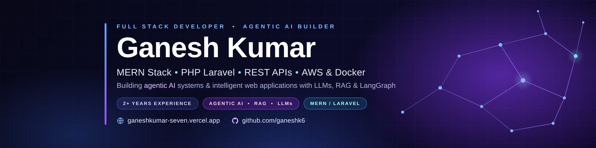

<!--
GitHub Profile README for: https://github.com/ganeshk6
Upload this README.md and the assets/ folder to a PUBLIC repository named exactly: ganeshk6
Before publishing, replace any contact/portfolio links if your current links have changed.
-->

  

  

  
  
  
  

---

## 👋 About Me

I'm **Ganesh Kumar**, a Full Stack Developer with **2+ years of professional experience** building web applications, backend services, REST APIs, dashboards, authentication flows, and business-focused software. My core hands-on experience is with the **MERN stack and PHP Laravel**, and I enjoy working across the application lifecycle—from understanding requirements and designing database-backed features to API integration, deployment, and maintenance.

I have worked on domestic and international client projects involving role-based access, business workflows, itinerary management, subscriptions, payment gateways, maps and weather services, and AI API integrations. I focus on writing maintainable code, building useful features, and learning tools that help solve real product problems.

- 💻 **Core focus:** Full Stack Development, MERN, PHP, and Laravel
- ⚙️ **Backend:** Node.js, Express.js, Laravel, REST API development, authentication
- 🗄️ **Databases:** MongoDB and MySQL
- 🔌 **Integrations:** Google Maps APIs, Weather APIs, payment gateways, and AI APIs
- ☁️ **Deployment & operations:** AWS fundamentals, Linux, Nginx, Docker, and CI/CD workflows
- 🤖 **AI direction:** Learning how to build LLM applications, RAG pipelines, and tool-using AI agents
- 🎯 **Career focus:** Full Stack Developer / MERN Developer / PHP Laravel Developer opportunities
- 🌍 **Location:** India; open to relocation

> I distinguish between technologies I have used in professional projects and tools I am currently learning. My current AI learning focus is listed separately below.

## 🧭 What I Build

| Area | Examples |
|---|---|
| 🌐 Full Stack Applications | End-to-end web apps, business portals, admin panels, and customer-facing experiences |
| ⚛️ Frontend Development | Responsive interfaces, reusable React components, forms, dashboards, and SPA workflows |
| 🔧 Backend Development | REST APIs, validation, business logic, database integration, and error handling |
| 🔐 Authentication & Access | Login flows, role-based permissions, protected routes, and session/token-based patterns |
| 🗺️ Location-Aware Apps | Places search, distance calculations, maps, itinerary management, and location-driven workflows |
| 💳 Payments & Subscriptions | Payment gateway integration, subscription flows, and order/payment workflows |
| 🤖 AI-Powered Features | Integrating AI APIs into existing applications; learning retrieval and agentic patterns |
| ☁️ Delivery & Deployment | Environment configuration, Linux-based deployments, web server setup, and CI/CD basics |

## 🛠️ Tech Stack

### Core development — hands-on experience

  

| Category | Technologies |
|---|---|
| **Frontend** | JavaScript, React.js, Inertia.js, HTML5, CSS3, Bootstrap, Tailwind CSS, Vite |
| **Backend** | Node.js, Express.js, PHP, Laravel, REST APIs, middleware, request validation |
| **Databases & ORM** | MongoDB, MySQL, Sequelize; relational schema design and query writing |
| **Web engineering** | Authentication, role-based access, CRUD workflows, API integration, reusable components, debugging |
| **Developer tools** | Git, GitHub, Postman, VS Code, npm |

### APIs and third-party integrations

  
  
  
  
  
  
  

Experience integrating external services for features such as location and distance lookup, weather information, AI-powered functionality, and payment processing. The exact provider and workflow depend on the project.

### Cloud, deployment, and DevOps

  

- **AWS:** EC2, S3, IAM fundamentals, and deploying application workloads
- **Server environment:** Ubuntu/Linux, Nginx configuration, environment variables, and application troubleshooting
- **CI/CD:** GitHub Actions workflows and build/deployment pipelines
- **Containers:** Docker fundamentals and container-based development/deployment concepts
- **Hosting platforms:** Vercel and Netlify for frontend projects

### AI engineering — currently learning and exploring

I'm actively building my understanding of LLM-powered applications. These are learning and exploration areas, not a claim of years of production experience with each framework.

  
  
  
  
  
  
  
  

Current learning roadmap:

- **LLM fundamentals:** tokens, context windows, model inputs/outputs, structured output, and prompt design
- **Embeddings & vector search:** representing content as embeddings, similarity search, metadata filtering, and vector database concepts
- **RAG pipelines:** document ingestion, chunking, retrieval, context construction, and grounding answers in source material
- **LangChain:** learning components for prompts, models, retrievers, tools, and chains
- **LangGraph:** learning graph-based agent workflows, state, branching, persistence, and human-in-the-loop patterns
- **AI agents:** tool calling, workflow orchestration, task decomposition, and deciding when an LLM should use a tool
- **Multi-agent systems:** exploring how specialized agents can collaborate, delegate work, and share structured results
- **Responsible AI application design:** evaluation, failure handling, latency/cost awareness, and protecting secrets in API integrations
- **Python & Django:** foundational knowledge; my professional hands-on work is primarily with PHP Laravel and the MERN stack

## 💼 Professional Experience

### Full Stack Developer — Script Venue
**October 2024 – Present**

- Develop and maintain full-stack web application features using React.js, Laravel/PHP, and MySQL.
- Build business workflows, role-based login/access, dashboards, and database-backed modules.
- Integrate external APIs, including Google Maps-related services, weather services, and OpenAI-powered functionality.
- Work on subscription and payment-related features, third-party services, and end-to-end application flows.
- Contribute to project delivery, debugging, and application lifecycle tasks in a Linux-based environment.

### PHP Laravel Developer — AppMingle Media

- Worked on PHP/Laravel application development and backend feature implementation.
- Built and maintained application functionality, business logic, and database-connected workflows.

### MERN Stack Developer — AbTechZone
**December 2023 – February 2024**

- Worked with MongoDB, Express.js, React.js, and Node.js on full-stack development tasks.
- Practiced frontend/backend integration and database-driven application workflows.

## 🚀 Featured Projects

### 1. Expense Tracker — Full Stack Expense Management
A web application for managing expenses and reviewing spending across different time periods.

**Highlights**
- User authentication and protected API endpoints
- Expense listing with pagination and date-based filtering
- Backend built with Node.js, Express.js, and Sequelize
- MySQL database integration
- Premium subscription/payment workflow using Cashfree sandbox integration
- CSV export workflow connected with AWS S3
- EJS-based views and Tailwind CSS styling

**Tech:** Node.js · Express.js · EJS · Sequelize · MySQL · JWT · Cashfree · AWS S3 · Tailwind CSS

### 2. Itinerary & Travel Management Features
Full-stack travel-related workflows that combine a web interface with location-aware information and third-party APIs.

**Highlights**
- React and Inertia.js frontend integrated with a Laravel backend
- Google Maps Places and distance-related API integration
- Weather API integration to provide destination context
- Itinerary and trip-related workflows
- Role-aware application functionality and backend data handling

**Tech:** React.js · Inertia.js · Laravel · PHP · MySQL · Google Maps APIs · Weather APIs

### 3. AI API Integration Features
AI-powered features integrated into web application workflows using external model APIs.

**Highlights**
- API-based integration with OpenAI and other AI providers
- Sending application context to an AI service and handling responses
- Connecting AI capabilities with practical application features
- Ongoing learning around RAG, vector retrieval, LangChain, LangGraph, and agent workflows

**Tech:** JavaScript · REST APIs · OpenAI API · Claude API · Gemini API

### 4. Personal Developer Portfolio
A personal portfolio to present my background, skills, experience, and projects.

**Highlights**
- React + TypeScript + Vite frontend
- Responsive, dark-themed design with blue/violet visual accents
- Experience, skills, projects, and contact sections
- Deployment workflow through GitHub and Vercel

**Tech:** React.js · TypeScript · Vite · CSS · GitHub · Vercel

> Project descriptions are representative summaries. Add links to public repositories or live demos only when the corresponding project is publicly shareable.

## 📊 GitHub Statistics

  
  

  

## 🎯 Current Goals

- Build and ship maintainable full-stack applications with React, Node.js, Express, PHP, and Laravel.
- Improve API design, database modeling, testing, security, and code quality.
- Strengthen deployment and DevOps skills using AWS, Docker, Linux, and CI/CD.
- Learn how to create grounded LLM applications using RAG and vector search.
- Build practical AI workflows with LangChain, LangGraph, tool calling, and multi-agent patterns.
- Keep learning through hands-on projects and consistent problem-solving practice.

## 🤝 Let's Connect

I'm open to connecting with developers, recruiters, and teams working on useful web products. I'm especially interested in **Full Stack Developer, MERN Stack Developer, and PHP Laravel Developer** opportunities, as well as practical AI-integrated application work.

  
  
  

⭐ If something here interests you, feel free to explore my repositories and connect.

  Thanks for visiting my profile — let's build something useful. 🚀

